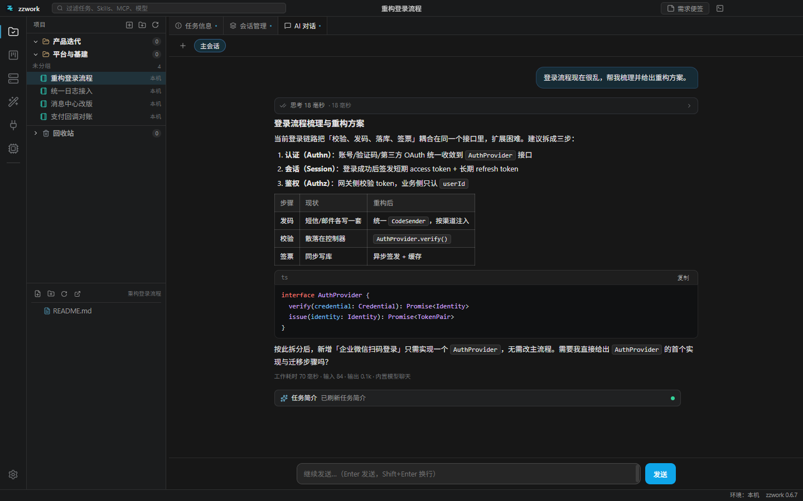
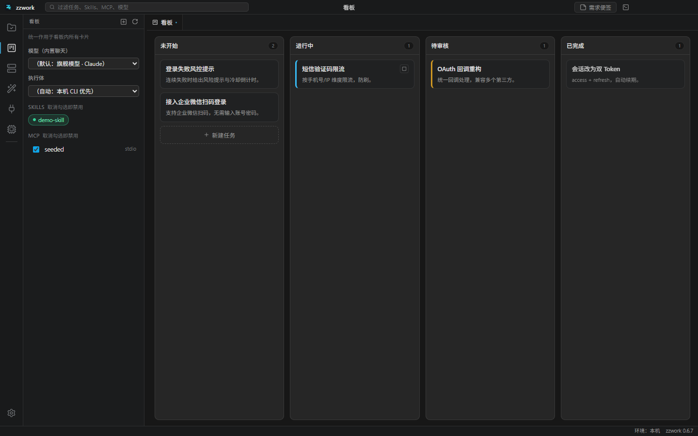
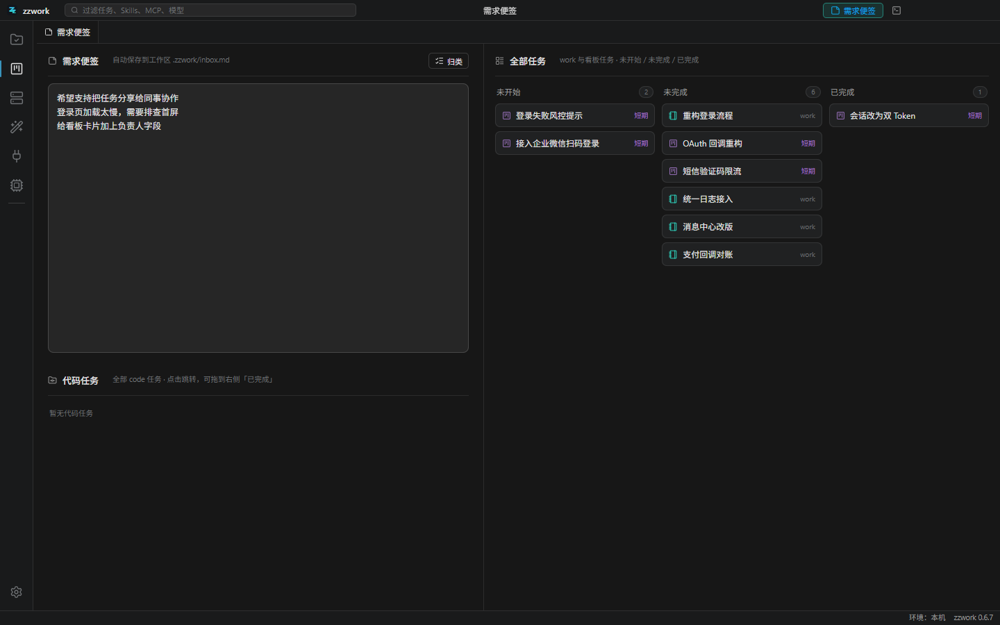
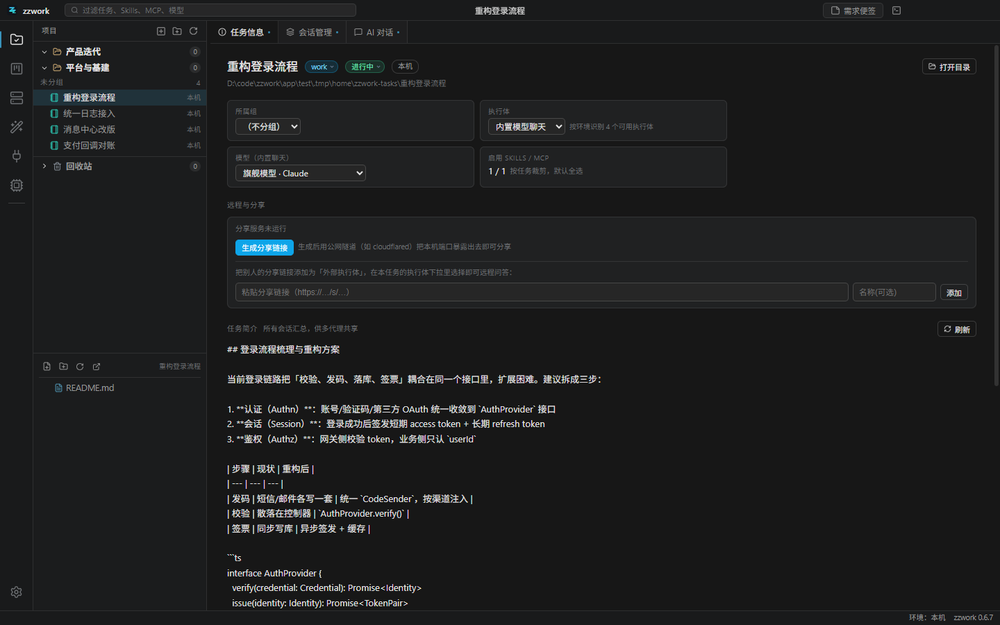

# zzwork · 个人 AI 工作台

> 把「项目 · 任务 · 看板 · 需求便签 · 环境 · AI 执行体 · 模型 · Skills · MCP」装进同一个桌面窗口的个人工作台。
> 一个专为「把 AI 编码助手当成日常生产力」的人打造的本地优先（local-first）工作台。


**zzwork** 是一个跨平台的个人 AI 工作台 / 任务工作台桌面应用：用任务树组织项目，每个任务就是一个目录、一个独立工作区；在同一套界面里管理本机 / WSL / SSH 环境、Claude Code · Codex · zcode 等 CLI 执行体、OpenAI 兼容 / Anthropic 模型、全局 Skills 与 MCP，并用内置的 AI 对话、看板、需求便签、功能图把「想法 → 任务 → 产出」串起来。

> zzwork is a local-first **personal AI workbench** desktop app. It organizes projects as task trees, treats every task as a workspace directory, and unifies local / WSL / SSH environments, AI coding agents (Claude Code, Codex, zcode…), OpenAI-compatible & Anthropic models, Skills and MCP servers — with built-in AI chat, a kanban board, idea inbox and feature map. Built with Electron + Monaco.



<table>
  <tr>
    <td width="50%"><br><sub>看板：任务卡片分列、拖拽流转</sub></td>
    <td width="50%"><br><sub>需求便签：随手记录、一键归类</sub></td>
  </tr>
  <tr>
    <td width="50%"><br><sub>任务信息：执行体 · 模型 · 环境 · 分享</sub></td>
    <td width="50%"><sub>更多截图见 <code>docs/images/</code></sub></td>
  </tr>
</table>

## 它解决什么问题

用 Claude Code、Codex 这类 AI 编码助手时，痛点往往不在模型本身，而在**周边**：

- 一堆项目散落在各个终端里，每个都要 `cd`、开进程、记命令；
- 本地、WSL、远程 SSH 三套环境的 CLI 各装各的，模型 Key 到处填；
- 灵感随手记在便签里，转头就忘，也没法一键变成可执行的任务；
- 想让 AI 读取项目上下文、复用 Skills/MCP，却要手工拼提示词。

zzwork 把这些收敛到一个桌面应用里：**任务即工作区，选中执行体就能对话，想法一键变任务，本地优先、数据都在你自己机器上。**

## 核心功能

- **个人工作台 · 任务树**：组 / 任务两级结构，`work`（资料类）与 `code`（代码类）两种任务类型，任务就是磁盘上一个目录。
- **AI 对话（内置 + CLI 执行体）**：内置模型流式对话；也能把 Claude Code（`stream-json` + `--resume` 会话记忆）、Codex、zcode 等 CLI 当执行体，跟随任务所在的本地 / WSL / SSH 环境自动选择、未安装时回退。
- **多环境执行体**：本机 / WSL 发行版 / SSH 远程；自动探测已安装的 `claude / codex / zcode / gemini…`，按环境识别、按任务绑定。
- **模型与提供方两级管理**：OpenAI 兼容 / Anthropic 两类提供方 → 多个模型；Key 按提供方用 Electron `safeStorage` 加密保存，全库唯一默认模型，任务未指定时自动跟随。
- **Skills 与 MCP**：全局 `~/.zzwork/skills`（`SKILL.md`），远程会话自动同步；`~/.zzwork/mcp.json` + 任务级 `.mcp.json`，支持真实握手测试（`initialize` + `tools/list`）。
- **看板 · 任务流转**：未开始 / 进行中 / 待审核 / 已完成四列，卡片可拖拽推进；「进行中」即由 AI 自动作答，可随时停止转到待审核。
- **需求便签（Inbox）**：随手记录零散需求，一键归类为「新建任务（看板 / 短期 + 分组）」或「忽略」，把需求文本写进任务提示词，不替你做决定。
- **功能图 & 画板**：把整个代码项目生成一张可增量的「功能网络」图；画板可自由绘制、双击标注、连线，补充描述随画板一起发送。
- **任务分享（可选）**：把某个任务生成外链，经自带公网隧道（如 cloudflared）只读共享给他人；对端作为「外部执行体」把问题转发到远端隐藏会话作答，暴露面限定为只读问答 + 只读文件浏览。
- **编辑器与文件树**：内置 Monaco 语言高亮、脏标记、`Ctrl+S` 保存；文件树支持新建 / 重命名 / 删除 / 在资源管理器显示；Markdown / HTML 可预览。
- **后台 Shell 与终端**：按任务独立的后台 Shell 面板与分屏终端，跟随卡片上下文。
- **版本更新**：启动与每 6 小时检查新版本，标题栏出现升级图标，一键下载安装（Linux 走浏览器下载页）。

## 适合谁

个人开发者、独立工作者、以及把 AI 编码助手当作生产力工具的人：同时维护多个项目 / 多种环境、习惯用 CLI 助手、希望「任务、上下文、模型、Skills/MCP」都在一个地方管起来。若你只想找个体面的 **AI 工作台 / 任务工作台 / AI Agent 桌面客户端** 来沉淀日常工作流，也可直接用它。

## 快速开始

从 [Releases](https://github.com/zuozuoxyz/zzwork/releases) 下载对应平台安装包，或本地源码运行：

```bash
cd app
npm install
npm run dev        # 开发模式
npm run build      # 构建产物到 app/out
npm run dist:win   # 打包 Windows（nsis 安装包 + portable + zip，输出 app/release）
npm run dist:mac   # 打包 macOS（dmg + zip，需在 macOS 上执行或走 CI）
npm run dist:linux # 打包 Linux（AppImage + deb + tar.gz，需在 Linux 上执行或走 CI）
```

### 发布

推送 `v*` 标签会触发 GitHub Actions（`.github/workflows/release.yml`）在
`windows-latest` / `macos-latest` / `ubuntu-latest` 上分别打包并发布到 GitHub Release：

```bash
git tag v0.6.7
git push origin v0.6.7
```

产物：Windows `zzwork-<version>-setup.exe`（另有 portable / zip）、macOS（Apple Silicon）
`zzwork-<version>-mac-arm64.dmg`（另有 zip）、Linux `zzwork-<version>-x86_64.AppImage`（另有 deb / tar.gz）。
mac 包未签名，首次打开需右键 →「打开」；Linux AppImage 首次需 `chmod +x` 后运行。

## 数据位置

- 业务库：`%APPDATA%\zzwork\data\zzwork.db`（macOS `~/Library/Application Support/zzwork/data/zzwork.db`，Linux `~/.config/zzwork/data/zzwork.db`，SQLite）
- 全局 Skills：`~/.zzwork/skills/<name>/SKILL.md`
- 全局 MCP：`~/.zzwork/mcp.json`
- 模型 Key：`%APPDATA%\zzwork\secrets.json`（Electron safeStorage 加密，明文只在主进程）
- 对话落盘：`<任务目录>/.zzwork/chat/`

> 全部为本地文件，无云端账号、无中继服务器。

## 结构

| 路径 | 说明 |
|---|---|
| `app/src/main/` | 主进程：IPC、SQLite、执行体、AI、文件系统、密钥 |
| `app/src/core/` | 纯 Node 模块（store / agentRunner / ai / envs / mcpTest） |
| `app/src/preload/` | 安全的 `window.zzwork` 桥 |
| `app/src/renderer/` | 界面：任务树、工作台、Monaco、文件树 |
| `docs/` | 设计文档、调研与界面截图 |

## 回归测试

```bash
cd app
npm test               # 构建 + 跑全套回归（170+ 个用例）
npm run test:only      # 直接跑（跳过构建）
node test/run.mjs 文件  # 只跑某个用例文件或名称过滤，如 models / 文件
```

测试通过 CDP 驱动真实 Electron 界面，每次运行都在 `app/test/.tmp` 下重新生成隔离环境
（独立的 SQLite、userData、HOME、工作目录），不会触碰真实数据；失败时截图保存到
`app/test/.tmp/shots/`。覆盖：项目/任务树、环境与执行体探测、Skills/MCP（含真实握手）、
模型两级管理、任务信息页、文件树与 Monaco 编辑保存、设置、AI 流式对话（假 SSE 服务与
假 CLI 执行体）、停止生成、任务分享服务、终端、文件系统与密钥安全边界。

## 常见问题

**需要联网账号吗？** 不需要。数据全在本地；只有你主动配置的模型提供方与（可选的）任务分享隧道会联网。

**和直接用 Claude Code / Codex CLI 有什么不同？** zzwork 不替代它们，而是把它们作为「执行体」纳入统一的个人工作台：项目/任务管理、多环境、模型与 Skills/MCP、看板与便签都在一个窗口，CLI 负责真正的执行。

**支持远程开发吗？** 支持 WSL 发行版与 SSH 远程环境，执行体按环境识别；MCP 配置会同步到远程。

**能共享任务给别人吗？** 可以，可选地把任务生成外链，经自带公网隧道只读共享（只读问答 + 只读文件浏览，凭 token 鉴权）。

## 已知问题

- SSH 环境的 MCP 写入走 base64 通道，大配置较慢。

---

关键词 / Topics：个人工作台 · AI 工作台 · 任务工作台 · AI Agent · Claude Code · Codex · MCP · Skills · 模型管理 · WSL · SSH · 看板 · 需求便签 · 功能图 · 本地优先 · Electron 桌面应用 · personal workbench · AI coding agents.
